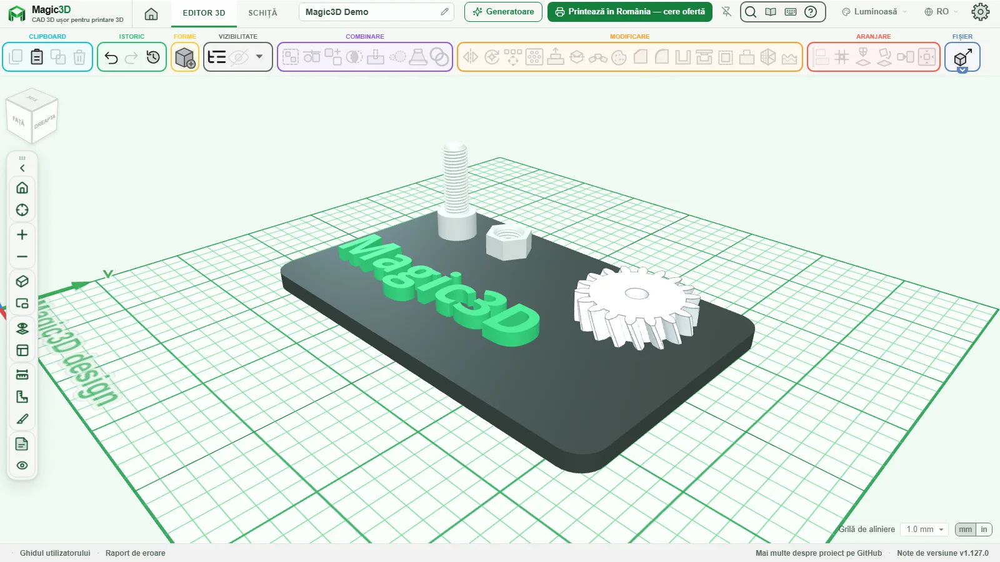

<p align="center">
  <a href="https://magic3d.ro"></a>
</p>

<h1 align="center">Magic3D — CAD 3D gratuit pentru printare 3D</h1>

<p align="center">
  <a href="https://magic3d.ro"><strong>magic3d.ro</strong></a> · editor 3D direct în browser, fără cont și fără instalare
</p>

<p align="center">
  Un proiect <a href="https://praktik3d.ro">Praktik3D</a>, atelier de printare 3D din București: desenezi aici, iar dacă n-ai imprimantă, printăm noi, cu livrare în toată România.
</p>

<p align="center">
  <a href="LICENSE"></a>
  
  
  
</p>

<p align="center">
  <a href="https://magic3d.ro"></a>
</p>

<p align="center"><a href="#english">English below</a></p>

## Ce este Magic3D

Magic3D e un program de proiectare 3D (CAD) pentru piese care se printează. Merge direct în browser, pe calculator sau
pe tabletă: nu-ți faci cont, nu instalezi nimic, iar proiectele rămân pe calculatorul tău.

E gândit pentru:

- **începători**, care construiesc o piesă din forme simple: cutii, cilindri, text, găuri;
- **cei care vin din Tinkercad**: comenzile sunt intenționat aceleași (tragi forme pe plan, grupezi găurile, aliniezi,
  oglindești), doar că nu mai dai de limitele de acolo;
- **școli și ateliere**: un mod simplu, cu mai puține unelte și butoane mai mari, făcut pentru clasă.

## Ce poți face

- **Forme și găuri:** o bibliotecă de forme (cutie, cilindru, text, roată dințată, cod QR, vază, Gridfinity, balama
  print-in-place și altele), fiecare putând fi solid sau gaură.
- **Grupare și operații booleene:** grupezi găurile cu solidele ca să tai canale, buzunare și orificii; intersecție,
  înfășurătoare, pachete de piese.
- **Muchii:** rotunjiri și teșituri pe geometrie CAD exactă, golirea corpurilor cu grosime uniformă de perete.
- **Filete:** șuruburi, piulițe, tije filetate și găuri filetate, metrice, UNC/UNF și Whitworth.
- **Schițe:** desenezi un contur cu măsuri exacte și îl extrudezi, îl rotești în jurul unei axe sau îl tragi de-a
  lungul unui traseu.
- **Export:** STL, 3MF (cu culori), STEP pentru alte programe CAD, plus OBJ, SVG și DXF; import din aceleași formate.
- **Pregătire pentru print:** profiluri pentru circa 230 de imprimante, avertizare de surplombă și estimare de filament.
- **Generatoarele Magic3D:** litere decorative, nume 3D, cuvinte, plăcuțe, brelocuri, rame, figurine articulate, fagure,
  cutii, litere și nume cu LED. Alegi câteva valori, iar modelul apare gata de print, apoi îl modifici liber în editor.
- **Offline și ca aplicație:** se instalează din browser sau ca aplicație Windows și merge și fără internet.

## Printează în România

N-ai imprimantă? Din editor apeși **„Printează în România — cere ofertă”**: alegi materialul, culoarea și cantitatea,
iar fișierele (3MF, STL și o imagine) pleacă împreună cu un mesaj pe WhatsApp către atelierul
[Praktik3D](https://praktik3d.ro) din București. Primești oferta, piesa se printează și ajunge prin curier oriunde în
țară. **Studenții** au reducere la printare cu legitimația sau carnetul de student.

Linkul către fișiere expiră după 20 de zile, apoi fișierele se șterg automat de pe server.

## Cum îl rulezi local

Ai nevoie de [Node.js](https://nodejs.org) 22.18 sau mai nou.

```bash
git clone https://github.com/firg3d/magic3d.git
cd magic3d
npm install
npm run dev
```

Editorul pornește pe <http://localhost:3000>. Alte comenzi utile:

```bash
npm run export      # site static în apps/web/.next-export, gata de urcat pe orice găzduire
npm test            # testele unitare
npm run typecheck   # verificarea tipurilor
```

**Docker** (pentru un NAS sau un server de acasă, fără Node.js instalat):

```bash
docker compose -f docker/compose.yml up -d --build
```

Imaginea se construiește din codul din acest folder, sub numele `magic3d:local`, și pornește pe portul 3000.

**Aplicația Windows** se construiește din `apps/desktop`; pașii sunt în [apps/desktop/README.md](apps/desktop/README.md).

Puntea MCP, prin care un asistent AI poate construi în editor, există doar în copiile găzduite local (`npm run dev`);
pe magic3d.ro e oprită.

## Cum contribui

- **Erori:** deschide un [issue pe GitHub](https://github.com/firg3d/magic3d/issues). Din editor, butonul
  **„Raport de eroare”** din subsol salvează o arhivă ZIP cu proiectul, browserul și ultimele mesaje; atașeaz-o la issue.
- **Cod:** fă un fork, lucrează pe o ramură, rulează `npm run typecheck` și `npm test`, apoi deschide un pull request.
  Textele din interfață au versiune în română și în engleză.
- **Idei și generatoare noi:** tot printr-un issue, cu o descriere sau o schiță a piesei.

## Susține Magic3D

Magic3D rămâne gratuit pentru toți. Dacă te ajută și vrei să contribui la dezvoltare, o poți face benevol, din butonul
**„Susține Magic3D”** din subsolul editorului sau direct de
[aici](https://praktik3d.ro/products/token-suporter-magic3d-sus%C8%9Bine-dezvoltarea?utm_source=magic3d&utm_medium=github).
În copiile proprii, linkul se setează la build cu `NEXT_PUBLIC_SUPPORT_URL`; fără el, butonul nu apare.

## Origine și licență

Magic3D este un fork al proiectului [layerling](https://github.com/henmedia/layerling), realizat de contribuitorii
layerling, preluat pe 31 octombrie 2026 de la layerling 1.127.0. layerling este, la rândul lui, un fork al proiectului
[SketchForge-3D](https://github.com/Formsmith746/SketchForge-3D), realizat de Formsmith746 și contribuitorii
SketchForge, preluat pe 16 septembrie 2026 de la SketchForge 1.0.9. Magic3D adaugă generatoarele parametrice Magic3D
(litere, nume, brelocuri, cutii, fagure, litere LED și altele, în `apps/web/src/magic3d/`), pagina de start, cererea
de ofertă „Printează în România”, aplicația Windows și traducerea în română.

Copyright (C) 2026 Magic3D contributors.
Copyright (C) 2026 layerling contributors.
Copyright (C) 2026 SketchForge contributors.

Magic3D este o versiune modificată a layerling, care este o versiune modificată a SketchForge-3D. Toate trei sunt
licențiate sub **GNU Affero General Public License v3.0 only** (`AGPL-3.0-only`). Textul complet al licenței e în
[LICENSE](LICENSE).

Dacă modifici Magic3D și lași alți oameni să folosească versiunea modificată printr-o rețea, secțiunea 13 a licenței
îți cere să le oferi codul sursă corespunzător. Editorul are pentru asta un link către cod: setează la build
`NEXT_PUBLIC_SOURCE_CODE_URL` la adresa publică a codului din care provine build-ul tău.

Tematicile și bazele 3D ale generatoarelor (`apps/web/public/magic3d/tematici`, `apps/web/public/magic3d/base`) sunt
create de Praktik3D și sunt licențiate separat, sub
[CC BY-NC-SA 4.0](apps/web/public/magic3d/LICENTA-tematici-CC-BY-NC-SA-4.0.txt). Fonturile vin cu propriile licențe,
listate în [apps/web/public/magic3d/fonts/LICENTE.md](apps/web/public/magic3d/fonts/LICENTE.md).

Documentația originală layerling e păstrată în [docs/upstream/](docs/upstream/).

Tinkercad este marcă înregistrată a Autodesk, Inc. Magic3D este un proiect independent și nu este afiliat, susținut
sau sponsorizat de Autodesk.

---

## English

**Magic3D** is free 3D CAD for 3D printing, right in your browser: no account, no installation, and your designs stay
on your computer. Try it at **[magic3d.ro](https://magic3d.ro)**. It is made by [Praktik3D](https://praktik3d.ro), a
3D printing workshop in Bucharest, Romania.

- **Who it is for:** beginners, people coming from Tinkercad (the controls are deliberately the same), schools and
  workshops (a simple mode with fewer tools and larger buttons).
- **What it does:** shapes and holes, grouping and boolean operations, fillets and chamfers on exact CAD geometry,
  hollowing, threads (metric, UNC/UNF, Whitworth), sketches, export to STL, 3MF and STEP (plus OBJ, SVG, DXF), printer
  profiles with overhang warnings, and the Magic3D generators (decorative letters, 3D names, keychains, frames, boxes,
  honeycomb, LED letters and more). It works offline and installs as an app, including a Windows app.
- **Print in Romania:** the editor's "Print in Romania – ask for a quote" button sends your files with a WhatsApp
  message to the Praktik3D workshop, which prints and ships across the country. Students get a printing discount.
- **Run it locally:** Node.js 22.18+, then `npm install` and `npm run dev` (http://localhost:3000), or
  `docker compose -f docker/compose.yml up -d --build`. The MCP bridge for AI assistants exists only in locally hosted
  copies.
- **Contribute:** report bugs as [GitHub issues](https://github.com/firg3d/magic3d/issues) (the editor's "Bug report"
  button saves a ZIP to attach); pull requests are welcome.
- **Support Magic3D:** voluntary, through the "Support Magic3D" button in the editor's footer.
- **Origin and licence:** Magic3D is a fork of [layerling](https://github.com/henmedia/layerling), itself a fork of
  [SketchForge-3D](https://github.com/Formsmith746/SketchForge-3D). Copyright (C) 2026 Magic3D contributors,
  layerling contributors and SketchForge contributors. Licensed under the GNU Affero General Public License v3.0 only
  (`AGPL-3.0-only`); see [LICENSE](LICENSE) and the full Romanian section above.
